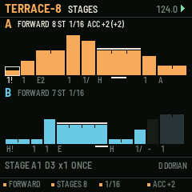
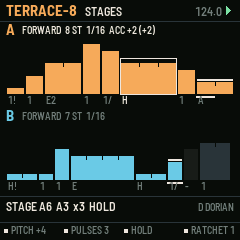
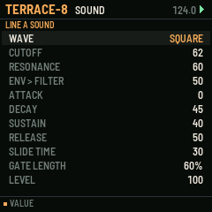

# TERRACE-8

A stage sequencer for the M-VAVE FM-1. One of six sequencer firmwares built from a survey of sequencer archetypes (see the companion survey). Built on fm1-base; makes its own sound and sends MIDI.

## What it is for

**Archetype:** Stage / elastic time: Intellijel Metropolis and Metropolix, Moog 960.

TERRACE-8 makes time part of the step. Each of eight stages has a pitch and a number of pulses it
lasts, with a gate mode deciding what happens across those pulses (once, every pulse, held through, every other,
silent), plus ratchets, slide, accent and skip. Eight values become phrases of up to 64 pulses with the swing and
stutter of acid and analogue bass lines, without a 64-step grid. Two lines of different lengths cross against each
other, and an accumulator lifts a line through the scale each time round. The screen draws each stage as a terrace:
as wide as it lasts and as high as it sounds.

## What it does

- 2 lines x 8 stages: pitch (scale degree), pulses 1-8, gate mode, ratchets 1-4, slide, accent, skip.
- Directions: forward, backward, ping-pong, random, random walk; stages in play 1-8; pulse length 1/32 to 1/4.
- Accumulator: degrees added each time round, back to zero past its limit.
- Hold a stage's white key: the knobs are that stage (pitch, pulses, gate, ratchets); black keys set its gate mode, slide, skip, accent.
- REC: the keys write pitches into the stages one after another (MIDI in too).
- Dice a line's pitches with undo; re-sync; key and scale with SEL.

## The controls

Hold any button alone for a second for its help card on the screen.

| Control | What it does |
| --- | --- |
| white keys 1-8 / 9-16 | line A / line B stages (held: the knobs are the stage) |
| black keys 1-5 | gate mode: silent, once, every, hold, every other |
| black keys 6-8 | slide, skip, accent |
| K1-K4 (nothing held) | direction, stages in play, pulse length, accumulator of the line |
| SELECT / PRESETS | the stage's pitch / pulses |
| ALGO | the line |
| REC | keys write the stages |
| ARP / SEQ | dice / undo |
| FX | re-sync |
| LFO | mute the line |
| EDIT / GLO / HOME | the line's SOUND / SETUP / the stages |
| SEL + PRESETS / SELECT | scale / root |
| OCT | the line's octave |

Common to all six: PLAY starts and stops, SAVE saves to the project slot, OCT- / OCT+ the octave.

## Screens

  

## Build, test, install

The firmware is built with [fm1-base](https://github.com/charlesvestal/fm1-base) (vendored in `base/`) and JieLi's
toolchain, which runs in Docker on macOS (`colima start` first). Python 3.11 with Pillow.

    ./build.sh --host              # the host simulator, then every test in app/tests/
    ./build.sh --shots             # the screenshots in app/docs/img/
    ./build.sh                     # a development package: app/build/terrace-8.fwsc
    ./build.sh --release 0.1       # a release package: app/build/terrace-8-0.1.fwsc

Install over USB with fm1-base's installer (the FM-1 connected, Python with `python-rtmidi`):

    python3.11 base/tools/fm1_install.py app/build/terrace-8-0.1.fwsc

Keep M-VAVE's stock firmware and M-UPGRADE at hand: the installer can put the stock firmware back.

## Layout

| Path | What |
| --- | --- |
| `app/seq.c` | the sequencer: its data and the engine (runs inside the audio render, sample-exact) |
| `app/ui.c` | the controls and the screen |
| `app/app.c`, `app/app.h` | the contract with fm1-base |
| `app/core/` | shared with the five sibling firmwares: synth (8 voices, 11 drums, echo), transport and MIDI clock, project slots, controls kit, text |
| `app/tests/` | host-simulator scripts: `basic.txt` (behaviour) and `screens.txt` (pictures) |
| `app/fm1.toml` | build settings, package identity `FM-1_25`, firmware.json fields |
| `base/` | fm1-base and felucca-bsp, vendored (MPL-2.0) |

## Common to all six

- Its own sound: an 8-voice synth (saw, square, triangle, sine, noise, super-saw; resonant filter; ADSR; glide),
  eleven synthesised drums on General MIDI notes, and a shared echo. Every part also goes out as MIDI (its channel set
  on its sound page) over USB and Bluetooth MIDI.
- MIDI clock: INTERNAL (and send clock, start, stop) or FOLLOW an incoming clock. MIDI notes in play the part shown.
- Four project slots (SETUP / GLO page). SAVE while playing saves at the stop.
- Hold any button alone for a second: a help card explains it.

## Status

**0.1, untested on hardware.** It builds for the FM-1, passes its host-simulator tests, and its screens are taken
from the simulator. Nothing has been run on a real FM-1 yet; CPU load of the synth on the device is not measured.

## Licence

MPL-2.0, as fm1-base. After the Intellijel Metropolis and the Moog 960.

You can also try Terrace 8 in the browser, no flashing needed, in the free community [FM-1 Emulator](https://fm1-emulator.atst.tools/).
