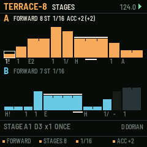
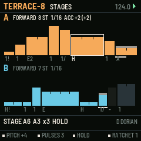
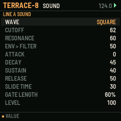

# TERRACE-8

A stage sequencer for the M-VAVE FM-1. One of six sequencer firmwares built from a survey of sequencer archetypes (see the companion survey). Built on fm1-base; makes its own sound and sends MIDI.

## What it is for

**Archetype:** Stage / elastic time: Intellijel Metropolis and Metropolix, Moog 960.

TERRACE-8 makes time part of the step. Each of eight stages has a pitch and a number of pulses it
lasts, with a gate mode deciding what happens across those pulses (once, every pulse, held through, every other,
silent), plus ratchets, slide, accent and skip. Eight values become phrases of up to 64 pulses with the swing and
stutter of acid and analogue bass lines, without a 64-step grid. Two lines of different lengths cross against each
other, and an accumulator lifts a line through the scale each time round. The screen draws each stage as a terrace:
as wide as it lasts and as high as it sounds.

## What it does

- 2 lines x 8 stages: pitch (scale degree), pulses 1-8, gate mode, ratchets 1-4, slide, accent, skip.
- Directions: forward, backward, ping-pong, random, random walk; stages in play 1-8; pulse length 1/32 to 1/4.
- Accumulator: degrees added each time round, back to zero past its limit.
- Hold a stage's white key: the knobs are that stage (pitch, pulses, gate, ratchets); black keys set its gate mode, slide, skip, accent.
- REC: the keys write pitches into the stages one after another (MIDI in too).
- Dice a line's pitches with undo; re-sync; key and scale with SEL.

## The controls

Hold any button alone for a second for its help card on the screen.

| Control | What it does |
| --- | --- |
| white keys 1-8 / 9-16 | line A / line B stages (held: the knobs are the stage) |
| black keys 1-5 | gate mode: silent, once, every, hold, every other |
| black keys 6-8 | slide, skip, accent |
| K1-K4 (nothing held) | direction, stages in play, pulse length, accumulator of the line |
| SELECT / PRESETS | the stage's pitch / pulses |
| ALGO | the line |
| REC | keys write the stages |
| ARP / SEQ | dice / undo |
| FX | re-sync |
| LFO | mute the line |
| EDIT / GLO / HOME | the line's SOUND / SETUP / the stages |
| SEL + PRESETS / SELECT | scale / root |
| OCT | the line's octave |

Common to all six: PLAY starts and stops, SAVE saves to the project slot, OCT- / OCT+ the octave.

## Screens

## Install

Use the [installer page](../install/) in Chrome or Edge with the FM-1 connected by USB. Keep M-VAVE's stock firmware
and M-UPGRADE at hand: the installer can put it back. To build it yourself, see the
[source](https://github.com/davidpryan/terrace-8).

## Status

0.1, untested on hardware. It builds for the FM-1 and passes its host-simulator tests; nothing has been run on a real
FM-1 yet.
